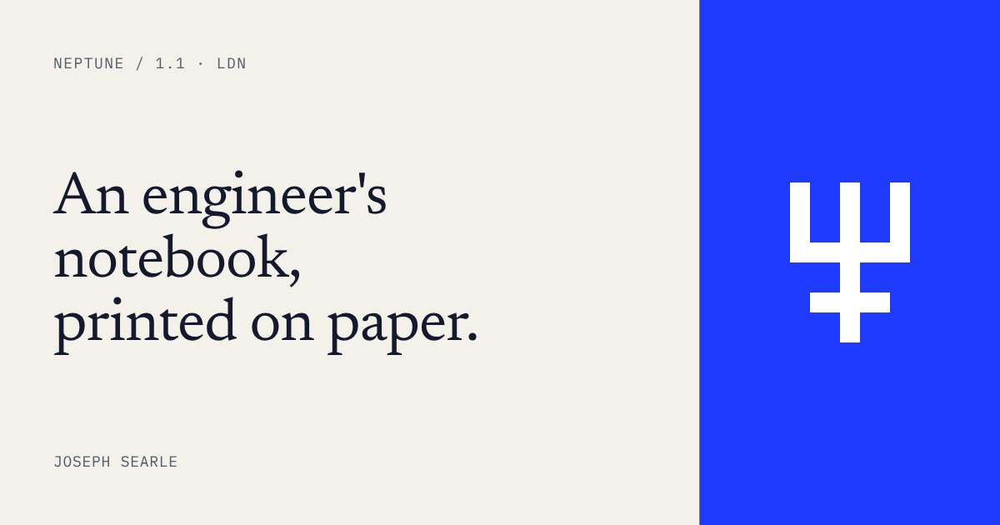

<div align="center">
<a id="readme-top"></a>

<h1>Neptune</h1>

<a href="https://github.com/JosephSearle/neptune">
  
</a>

<p>
  <a href="https://github.com/JosephSearle/neptune/actions/workflows/ci.yml"></a>
  <a href="https://github.com/JosephSearle/neptune/actions/workflows/visual.yml"></a>
  <a href="https://github.com/JosephSearle/neptune/releases/latest"></a>
  <a href="#license"></a>
</p>

<p>
  <a href="llms.txt">llms.txt</a> ·
  <a href="https://github.com/JosephSearle/neptune/issues/new">Report a bug</a> ·
  <a href="https://github.com/JosephSearle/neptune/issues/new">Request a component</a>
</p>
</div>

> Joseph Searle's personal brand and design system: an engineer's notebook printed on paper.

Neptune 1.1 (2026-10-13) is Joseph Searle's personal brand: an engineer's notebook printed on paper. Classical serif for ideas, monospace for anything a machine would say, one electric blue for action. Light paper by default; Deep is the dark theme.

Code, tooling and history live in [JosephSearle/neptune](https://github.com/JosephSearle/neptune): the DTCG token export, `llms.txt` for agents and the CI checks are there, not in the design system page.

Built with:

- Plain CSS: tokens as CSS variables plus `np-` component classes, no framework.
- [Newsreader](https://fonts.google.com/specimen/Newsreader) and [IBM Plex Mono](https://fonts.google.com/specimen/IBM+Plex+Mono).
- [W3C Design Tokens](https://www.designtokens.org/) (DTCG 2025.10) export.
- [Playwright](https://playwright.dev/) for visual regression, [stylelint](https://stylelint.io/) for the CSS lint.
- [GitHub Actions](https://docs.github.com/actions) for checks and releases.

<details>
<summary>Table of contents</summary>

- [Install](#install)
- [Usage](#usage)
- [Voice](#voice)
- [Colour](#colour)
- [Type](#type)
- [Space and shape](#space-and-shape)
- [Layout](#layout)
- [Docs pages](#docs-pages)
- [Slides](#slides)
- [Ornament](#ornament)
- [Imagery](#imagery)
- [Motion](#motion)
- [Accessibility](#accessibility)
- [Logo](#logo)
- [Versions](#versions)
- [Changelog](#changelog)
- [Maintainers](#maintainers)
- [Contributing](#contributing)
- [License](#license)

</details>

## Install

Neptune isn't on npm. Clone it, then install the tooling:

```bash
git clone https://github.com/JosephSearle/neptune.git
cd neptune
npm ci
```

To use it in a site, copy `tokens.css`, `components/bundle.css` and the `brand/` files you need. Nothing else ships to the browser.

### Dependencies

- A browser with CSS custom properties and `prefers-color-scheme`. No JavaScript runtime.
- Google Fonts, imported by `bundle.css`: Newsreader and IBM Plex Mono. Self-host for production.
- Tooling only: Node.js 22 (CI's version) for the token, `llms.txt` and lint scripts and Playwright.
- Brand files only: Python 3 with `fonttools`, `brotli` and `pillow`, for `scripts/build-brand.py`.

## Usage

Load two stylesheets, in this order, plus the fonts:

1. `tokens.css`: every token as a CSS variable, both themes, and a class per type style (`.display`, `.heading`, `.label`…).
2. `components/bundle.css`: the `np-` component classes.
3. Google Fonts: Newsreader (opsz, 300–700, italic) and IBM Plex Mono (400–600). `bundle.css` imports them; self-host for production.

Leave `data-theme` off `<html>` and the page follows the system setting; set `"light"` or `"dark"` when the reader picks one in the ThemeToggle. Wrap the page in `np-root`. Start `<body>` with a SkipLink, then the Nav, then `<main id="main" tabindex="-1">` with its content in `np-container`. Build pages from components: Nav, Hero, SectionHead, Card, Figure, Split, Feed, Table, Prose, CodeCopy, Footer. Docs pages add DocsLayout, Sidebar, Breadcrumb, ArticleHeader, Toc, Pager, Callout and Tabs. Forms use Input, Select, Textarea, Checkbox and Switch. Lay out index pages on PageGrid. Every site gets SearchDialog behind ⌘K and an EmptyState for anything that can come back empty. Feedback uses Toast for results, Dialog for decisions and Tooltip for optional hints; destructive actions go through a Dialog with `np-btn--danger`. Style nothing inline that a component or type class already covers.

### Example

A page with a skip link and a hero, following the system theme:

```html
<!doctype html>
<html lang="en">
<head>
  <meta charset="utf-8">
  <link rel="stylesheet" href="tokens.css">
  <link rel="stylesheet" href="components/bundle.css">
  <link rel="icon" href="brand/favicon.svg" type="image/svg+xml">
</head>
<body class="np-root">
  <a class="np-skip" href="#main">Skip to content</a>
  <main id="main" tabindex="-1" class="np-container">
    <section class="np-hero">
      <span class="np-hero__eyebrow">NEPTUNE / 1.1 · LDN</span>
      <h1 class="np-hero__title">Notes on agents that <em>ship</em>.</h1>
      <p class="np-hero__lead">Playbooks and postmortems.</p>
    </section>
  </main>
</body>
</html>
```

Open it in a browser: a Paper page (Deep if the system is dark) with a serif headline, a mono eyebrow and a skip link that appears on the first Tab. Every component folder has a `preview.html` with working markup to copy.

### CLI

The tooling runs through npm scripts:

| Command | What it does |
| --- | --- |
| `npm run tokens` | Rebuild `tokens/dtcg/` and `tokens.css` from `tokens.json` |
| `npm run llms` | Rebuild `llms.txt` and `llms-full.txt` |
| `npm run lint` | Lint `components/` for raw colours and `z-index` |
| `npm run check` | Everything CI runs; writes nothing |
| `npm run visual` | Screenshot every preview in both themes and compare |

`python3 scripts/build-brand.py <newsreader-500.woff2>` rebuilds the logo, favicon set and social card from `tokens.json`; [CONTRIBUTING.md](CONTRIBUTING.md#making-a-change) has the full command.

### Tokens

`tokens.json` is the source of truth. `scripts/build-tokens.mjs` turns it into W3C DTCG files (format 2025.10) in `tokens/dtcg/`, for Style Dictionary, Terrazzo, Tokens Studio or Figma variables:

- `primitives.tokens.json`: raw colours by family and step (`primitive.blue.600`), from `tokens/primitives.json`.
- `base.tokens.json`: space, radius, stroke, layout, breakpoints, durations, z-index, fonts and type styles. Values DTCG has no type for (`68ch`, `steps(2)`) sit under `$extensions`.
- `paper.tokens.json`, `deep.tokens.json`: the semantic colours and shadow for each theme, as aliases of primitives.

Load primitives + base + one theme. Every semantic colour must alias a primitive: add the primitive first, then use it.

After changing `tokens.json`, `tokens/primitives.json` or `tokens.css`, run `node scripts/build-tokens.mjs`. CI runs it with `--check` and fails if the DTCG files or `tokens.css` disagree with `tokens.json`.

### For agents

`llms.txt` indexes the guide and every component for an LLM, with the rules agents most often break; `llms-full.txt` is the guide and all component READMEs in one file. Both are generated: after changing any README, run `node scripts/build-llms.mjs`. CI fails if they're stale.

### States

Buttons and fields share one set of states. Use the attribute, not a class:

| State | Button | Input, Select, Textarea |
| --- | --- | --- |
| Disabled | `disabled`, or `aria-disabled="true"` on a link with no `href` | `disabled`; box sinks to `paper-sunk` |
| Busy | `aria-busy="true"` plus `disabled`; a block cursor blinks after the label | — |
| Read-only | — | `readonly`; `paper-sunk`, still focusable |
| Invalid | — | `aria-invalid="true"` + `aria-describedby`; border, prompt and hint turn `alert` |

## Voice

- Write direct and terse. Short sentences. No filler ("simply", "in order to", "please note").
- Use the imperative for instructions and UI copy: "Read the playbook", not "You can read the playbook".
- Describe what a thing does, not how good it is. No marketing adjectives.
- Write errors as what went wrong, then what to do: "Build failed: missing `API_BASE_URL`. Set it in `.env`."
- Sentence case for headings. UPPERCASE only in mono labels.
- No emoji. Use the glyph set below instead.

### System metadata

Treat every page like a running program. Stamp it with mono metadata in `meta` style, `ink-muted`:

- Version and place: `NEPTUNE / 1.1 · LDN`
- Dates in ISO: `2026-10-13`
- Indexes on cards and sections: `01`, `02`, `03`
- Status in brackets: `[ SHIPPED ]`, `[ DRAFT ]`, `[ ARCHIVED ]`

Keep it true. A stamp that lies (fake version numbers, fake uptime) is decoration; cut it.

## Colour

- Set every page on `paper`. Raise cards, inputs and keys onto `paper-raised`. Recess code spans and footers into `paper-sunk`.
- Set text in `ink`; metadata and captions in `ink-muted`.
- Spend `neptune` on one thing per view: the primary action, a link, the active nav item, or the focus ring. Never as a large background except the hero block on the cover.
- Put `neptune` text on `neptune-soft` for accent tags and selections. Put `on-neptune` on a `neptune` fill.
- Draw meaningful borders (inputs, cards, tags, kbd) in `line-strong`. Use `line` only for decorative rules.
- Use `ok` and `alert` for state, always with a word or the `np-dot`. Never colour alone.
- Fill `alert` only for the danger button, with `on-alert` text.
- Charts take their own palette, `viz-`: six series hues in a fixed order led by `neptune`, a one-hue sequential ramp and a gold–blue diverging pair. The one-blue rule doesn't apply inside a plot. Chart has the rules; the numbers are measured there.
- Terminals, code blocks, toasts and tooltips stay dark in both themes: `term-bg` with `term-ink`, `term-muted` for prompts, `term-accent` for commands and actions, `term-ok` and `term-alert` for state.

## Type

- Headlines and body in Newsreader (`--font-serif`). Labels, buttons, nav, metadata and code in IBM Plex Mono (`--font-mono`).
- Hero: `display-xl`, once per page. Page title: `display`. Sections: `heading`. Cards: `title`.
- Reading text: `body`, max 68ch. Card copy: `body-sm`. Pull quotes: `quote`. Italic appears only there and on one emphasised word in a Hero title.
- Mono labels: `label`, uppercase, 0.08em tracking. Stamps: `meta`. Code: `code`.
- Never set paragraphs in mono. Never set buttons in serif.

## Space and shape

- Build on a 4px grid: `space-1` to `space-16`. Card padding `space-6`; gap between cards `space-8`; sections `space-16` on desktop, `space-12` on phones.
- Square by default: `radius-none` on cards, tags and terminals; `radius-sm` (2px) on buttons, inputs and keys; `radius-full` only on status dots and radio buttons.
- Every border is `stroke-hairline` (1px). The kbd bottom edge and focus ring are `stroke-key` (2px).
- No blurred shadows. Hover lift is `shadow-press`: a hard 3px offset plus a 2px translate.
- Lay pages on a visible grid where it helps: PageGrid with `np-grid--rules` draws hairline column rules in `line`; align content to them.

## Layout

- Centre page content in `np-container`: max width `container` (1200px), side padding `gutter` (24px), `gutter-sm` (16px) below `bp-sm`.
- Stop reading text at `measure` (68ch) and leads under headings at `measure-short` (52ch). Components apply both; don't set `max-width` on text inline.
- Three breakpoints. Below `bp-lg` (1080px) the Docs layout hides its On this page column. Below `bp-md` (720px) Nav collapses to Menu, Split rows stack and Docs drops to one column. Below `bp-sm` (640px) display type drops one step, Feed rows and the Pager stack, and the gutter narrows. Check every page at 390px and 1280px.
- Layers: `z-menu` for menus, `z-dialog` for dialogs, `z-toast` for the toast stack, `z-tooltip` for tooltips. Nothing else sets a z-index.

## Docs pages

Build a docs page from one recipe, in this order:

1. `np-docs` with three children: `np-docs__side` (Sidebar), `np-docs__main`, `np-docs__toc` (On this page).
2. In main: Breadcrumb, then ArticleHeader, then Prose. Put Callouts and Tabs inside the Prose.
3. End main with a Rule and the Pager.

One page, one `aria-current` per list: the open page in the Sidebar, the visible heading in On this page.

## Slides

Decks use the same palette and faces at slide scale. Measured in the stress-test deck, 2026-10-13.

- Canvas 1920×1080, 128px margins, footer band at 64px from the bottom.
- Type: the `Slides` group in tokens: `slide-display` 200, `slide-statement` 120, `slide-quote` 88, `slide-title` 72, `slide-body` 32, `slide-label` 24. Nothing below 24px: `label` and `meta` both become `slide-label`.
- Hairlines double to 2px. 1px disappears on a projector.
- Slide tools take hex, not variables: use the values in `tokens.json` for the slide's theme.
- Rhythm: Paper for content, Deep for quotes and terminals, one `neptune` statement slide with `on-neptune` text near the end.
- Every content slide: eyebrow (`02 · Tools`), title at the top margin, one idea, footer stamp `NEPTUNE / 1.1 · 03`.
- Status in tables: the colour plus a word and a `●`.

## Ornament

Use typographic glyphs, not icons or emoji. In mono, `ink-muted`:

| Glyph | Use |
| --- | --- |
| `→` | Link and button suffix: "Read more →" |
| `›` | Prompt: inputs, breadcrumbs |
| `·` | Separator in metadata strings |
| `∴` | Section break centred in `np-rule` |
| `◆` | Bullet for featured items |
| `┌ ┐ └ ┘` | Corner marks framing a figure or hero image |
| `⌘K` | Search, always in `np-kbd` |
| `▾` | Open disclosure and select menus |
| `←` | Previous, in the Pager only |

## Imagery

- Prefer dithered or halftone treatments of classical subjects (sculpture, engravings, star charts) printed in `ink` on `paper`, or `neptune` on `paper` for one hero.
- Diagrams in hairlines, labelled in `meta`.
- No stock photos, no 3D blobs, no purple gradients.
- Frame every image in Figure (or the Card image slot). No bare images on paper.
- An image you don't have yet is an `np-slot` with a bracketed label (`[ Image · 16:9 ]`), never a grey box or a stock stand-in.

## Motion

- Fast and stepped: `duration-step` (80ms) with `easing-step` (`steps(2)`) for hover lift. Nothing eases in slowly.
- A blinking block cursor in terminals is the one ambient animation.
- Respect `prefers-reduced-motion`: drop the cursor blink and the lift.

## Accessibility

- Measured 2026-10-13: every text pair meets 4.5:1 in both themes. Tightest: `alert` on `paper-sunk` 4.59:1 (Paper); `neptune` on `neptune-soft` 5.16:1 (Deep); `ink-muted` on `neptune-soft` 5.47:1 (Paper). Re-measure when a colour changes.
- `line-strong` meets 3:1 on every paper surface, lowest 3.34:1 (Deep, `paper-raised`). `line` measures 1.3–1.5:1: decoration only, never the only edge of a control.
- Terminals and code blocks carry a `line` border: in Deep, `term-bg` almost matches `paper` and the block would lose its edge.
- On touch screens, buttons, nav links, toggles and inputs grow to a 44px target.
- Focus: 2px solid `focus`, 2px offset, on every interactive element. One rule in `bundle.css` sets it for everything inside `np-root`; don't override it.
- Status always carries a word, never colour alone.
- Every page starts with a SkipLink to `<main id="main">`. Text that only screen readers need goes in `np-visually-hidden`.
- Forced colours (Windows contrast themes): state carried by a fill or a blue glyph gets a system colour or an underline instead. Checkboxes, switches, the ThemeToggle, Tabs, the active nav link and search results all stay readable.
- Print is always Paper: nav, sidebars, search and toasts drop out, terminals print as outlined ink, and external links print their URL.
- Errors are announced, not just coloured: `aria-invalid="true"` on the control, `aria-describedby` pointing at the hint. Disabled controls say why in their hint.

## Logo

The mark is Neptune's trident (♆), square-stroked on a 24-unit grid in a `neptune` tile; the lockup adds the wordmark, "Neptune" in Newsreader 500 at -0.01em. Files, sizes, clear space and the favicon and social card are in Logo. Where the mark would be the only blue on a page that has spent its `neptune`, use the single-ink version.

## Versions

Neptune follows semantic versioning. The public surface is the token names, the `np-` classes and their documented markup.

- Major (2.0): removing or renaming a token, class, component or modifier; changing what a token means; markup changes existing pages must make.
- Minor (1.2): new tokens, components, variants and states; visual refinements that existing markup picks up unchanged.
- Patch (1.1.1): bug fixes, docs, and value nudges that keep contrast and meaning.

Deprecation comes before removal, for at least one minor release:

1. Mark it in its README: `[ DEPRECATED · 1.x · use np-new ]`, and in [CHANGELOG.md](CHANGELOG.md) under Deprecated.
2. Keep it working: an old class stays as an alias in `bundle.css`; an old token becomes an alias of the new one, its usage note starting "Deprecated:".
3. Remove it in the next major, listed under Removed with what replaces it.

A release updates the version stamps (README, Cover, Nav, Hero, Footer previews, `package.json`), moves the Unreleased entries in [CHANGELOG.md](CHANGELOG.md) under the new number, and bumps `package.json`; on push, the release workflow tags `vX.Y.Z` and publishes the GitHub release from that section.

## Changelog

Every release, newest first, is in [CHANGELOG.md](CHANGELOG.md). The current release is 1.1.0.

## Maintainers

- Joseph Searle ([@JosephSearle](https://github.com/JosephSearle))

## Contributing

Neptune is a personal system, so it doesn't take pull requests for new direction. Bug reports and fixes are welcome. Read [CONTRIBUTING.md](CONTRIBUTING.md) for how to report a bug, set up, and get a pull request merged.

Before you push, run the checks:

```bash
npm run check
npm run visual
```

`npm run check` runs everything CI runs: tokens in sync, `llms.txt` current, and a stylelint pass on `components/` that rejects raw colours (hex, `rgb()`, named colours) and any `z-index` that isn't a `z-` token. A new colour goes into `tokens.json` (and `tokens/primitives.json`) first.

Visual regression: `tests/visual.spec.js` screenshots every component preview in Paper and Deep, with the brand fonts served locally, and CI compares them with `tests/__screenshots__` on every push. After an intended visual change, run the **visual** workflow by hand with *update* ticked; it rewrites the baselines in the same container CI uses and commits them.

Follow [Versions](#versions) for anything that changes a token, class or component.

## License

UNLICENSED. © 2026 Joseph Searle. All rights reserved.
